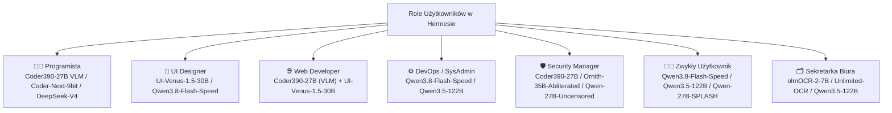

# Przewodnik Użytkownika: Jak i Do Czego Używać Hermesa z Modelami oMLX

Praktyczna instrukcja obsługi agenta **Hermes** współpracującego z lokalnym serwerem **oMLX** na platformie Apple Silicon (Mac Studio 192 GB Unified Memory). Dokument zawiera ściągawkę z najważniejszych komend CLI oraz dobór optymalnych modeli z bazy **17 skonfigurowanych modeli** pod kątem konkretnych ról zawodowych i codziennych scenariuszy użycia.

---

## 1. Szybki Start – Podstawowe Komendy Hermesa

### Uruchamianie sesji z wybranym modelem
Domyślnie Hermes startuje z modelem głównym `Qwen3.5-122B-A10B-MLX-9bit`. Aby uruchomić go od razu z innym modelem, użyj flagi `-m`:

```bash
# Start z domyślnym modelem (Qwen3.5-122B)
hermes

# Start z ultra-szybkim modelem kodistycznym Coder390 (27B VLM, ~34.6 tok/s, MTP + DFlash)
hermes -m Qwen3.8-27B-Coder390-EfficientThink-Opus5.5-GPT6Astra-Grok4.7-DSV4Pro-K3-SFT-RLOO-MTP-DFlash2

# Start z najszybszym modelem ogólnym (~73.5 tok/s z tablicą ngramów)
hermes -m Qwen3.8-Flash-Next-MTPLX-Optimized-Speed

# Błyskawiczne polecenie z linii komend napędzane silnikiem Splash (~50–70+ tok/s)
hermes -m Qwen3.8-27B-Uncensored-MLX-SPLASH -z "Przedstaw w 3 punktach podsumowanie kluczowych zalet silnika Splash w oMLX."
```

### Zmiana modelu i parametrów w trakcie rozmowy
W otwartej sesji czatu Hermesa możesz w każdej chwili przełączyć model bez utraty historii rozmowy:
* `/model` – otwiera interaktywne menu wyboru modelu lub pozwala wpisać nazwę, np.:
  ```text
  /model Qwen3.8-27B-Coder390-EfficientThink-Opus5.5-GPT6Astra-Grok4.7-DSV4Pro-K3-SFT-RLOO-MTP-DFlash2
  ```
* **Poziom rozumowania (`--reasoning`):** Możesz sterować głębokością myślenia (`<think>`):
  ```bash
  hermes -m DeepSeek-V4-Flash-0731-MXFP4-MLX --reasoning high
  ```
* **Praca na bezpiecznej kopii repozytorium (`--worktree`):** Idealne przy dużych refaktoringach:
  ```bash
  hermes -m Qwen3-Coder-Next-MLX-9bit --worktree
  ```

### Przełączanie Wariantów Kompresji i Serwera (`switch-variant.sh`)
W katalogu konfiguracyjnym (`~/Desktop/Devel/omlx_hermes_config`) znajduje się skrypt zarządzający zachowaniem pamięci i kompresora kontekstu:

```bash
# Wariant 1 (Domyślny / Zero-Swap): Kompresję wykonuje aktualnie załadowany model sesji (0s opóźnienia)
./switch-variant.sh 1

# Wariant 2 (Dual-Model): Qwen 122B jako główny + przypięty w RAM Qwen 27B (~15 GB) jako szybki kompresor
./switch-variant.sh 2

# Praca zdalna poza domem / z laptopa (automatycznie łączy się z Mac Studio przez Tailscale VPN)
./switch-variant.sh 1 --remote
```

---

## 2. Dobór Modeli pod Kątem Ról (Use Cases)

Poniżej znajduje się zestawienie **7 ról użytkowników** wraz z przypisaniem najlepszych modeli spośród 17 dostępnych w naszym ekosystemie.



---

### 👨‍💻 Rola 1: Programista (Backend, Architektura, Algorytmy, Refaktoring)

Programista potrzebuje dwóch trybów pracy: **błyskawicznej pętli edycji kodu i uruchamiania testów** oraz **głębokiego rozumowania architektonicznego** przy skomplikowanych błędach.

| Zastosowanie | Rekomendowany Model | Dlaczego ten model? |
| :--- | :--- | :--- |
| **Codzienny coding, szybkie diffy, TDD, tool-calling** | **`Qwen3.8-27B-Coder390-EfficientThink-Opus5.5-GPT6Astra-Grok4.7-DSV4Pro-K3-SFT-RLOO-MTP-DFlash2`** | Wagi unquantized BF16 (~30.6 GB RAM), multimodalny VLM z MTP i akceleracją DFlash2. Generuje kod z prędkością aż **~34.6 tok/s** (4x szybciej niż modele MoE), czerpiąc z destylacji Opus 5.5, GPT-6 Astra, Grok 4.7 i DeepSeek V4 Pro. |
| **Ciężki refaktoring wielu plików, wysoka precyzja składni** | **`Qwen3-Coder-Next-MLX-9bit`** | Niemal bezstratna kwantyzacja 9-bitowa z rozszerzonym RoPE (theta 5M). Niezwykle stabilny przy generowaniu bardzo długich plików źródłowych i złożonych struktur. |
| **Złożona architektura, trudne algorytmy, analiza bugów** | **`DeepSeek-V4-Flash-0731-MXFP4-MLX`** *(lub lżejszy `AWQ`)* | Flagowy model MoE (~155 GB, MTP depth 3) z potężnym łańcuchem rozumowania (`deepseek_v4`) i oknem 256k (natywnie do 1M). Najlepszy do rozwiązywania problemów, na których inne modele utknęły. |

**Przykładowe użycie:**
```bash
# Szybka sesja programistyczna i naprawa testów
hermes -m Qwen3.8-27B-Coder390-EfficientThink-Opus5.5-GPT6Astra-Grok4.7-DSV4Pro-K3-SFT-RLOO-MTP-DFlash2 -z "Przeanalizuj błędy w pytest, znajdź przyczynę wyścigu wątków w module worker.py i zastosuj poprawkę."

# Głęboki przegląd architektury na osobnej gałęzi roboczej
hermes -m DeepSeek-V4-Flash-0731-MXFP4-MLX --worktree --reasoning high
```

---

### 🎨 Rola 2: UI Designer (Analiza Interfejsów, UX, Design Systems, Makiety)

UI Designer pracuje z obrazem: zrzutami ekranu aplikacji, eksportami z Figmy, siatkami odstępów, kontrastem i hierarchią wizualną. Wymaga modeli posiadających silny moduł **Vision (VLM)**.

| Zastosowanie | Rekomendowany Model | Dlaczego ten model? |
| :--- | :--- | :--- |
| **Analiza screenshotów UI, audyt UX, lokalizacja elementów** | **`UI-Venus-1.5-30B-A3B-qx86-hi-mlx`** | Wyspecjalizowany model multimodalny (Qwen 3 VL MoE) wytrenowany bezpośrednio do rozumienia interfejsów graficznych, hierarchii komponentów, dostępności (WCag) i wykrywania błędów wizualnych. |
| **Kreatywny brainstorming, copywriting UX, systemy designu** | **`Qwen3.8-Flash-Next-MTPLX-Optimized-Speed`** | Posiada wieżę wizyjną (`model-vision.safetensors`), a dzięki prędkości ~73.5 tok/s pozwala na błyskawiczne iterowanie wariantów mikrokopii (UX writing), palet kolorów i tokenów designu. |
| **Analiza wielkich makiet i dokumentacji wizualnej** | **`MiniMax-M3-ConfigI-MLX`** | Potężny model VLM (60 warstw, 128 ekspertów) zdolny połączyć analizę obrazu z długą specyfikacją produktową (128k okna). |

**Przykładowe użycie:**
```bash
# Audyt UX na podstawie zrzutu ekranu makiety
hermes -m UI-Venus-1.5-30B-A3B-qx86-hi-mlx -z "Przeanalizuj plik ./mockup_dashboard.png pod kątem czytelności hierarchii informacji, kontrastu przycisków CTA oraz spójności paddingów."
```

---

### 🌐 Rola 3: Web Developer (Full-Stack, React/Next.js, Tailwind CSS, Design-to-Code)

Web Developer łączy świat UI Designera i Programisty: musi przekształcić projekt graficzny w działający, responsywny komponent HTML/CSS/React, a gdy coś się rozjedzie w przeglądarce – pokazać modelowi zrzut ekranu i kod jednocześnie.

| Zastosowanie | Rekomendowany Model | Dlaczego ten model? |
| :--- | :--- | :--- |
| **Tworzenie komponentów React/Vue/Tailwind + podgląd wizji** | **`Qwen3.8-27B-Coder390-EfficientThink-Opus5.5-GPT6Astra-Grok4.7-DSV4Pro-K3-SFT-RLOO-MTP-DFlash2`** | Model programistyczny z **aktywną wieżą wizyjną (`supports_vision: true`)** i pełną precyzją BF16! Możesz wkleić mu screenshot rozjechanego modala w przeglądarce, a on sam przejrzy kod CSS i naprawi flexbox/grid. |
| **Konwersja makiety na kod (Screenshot-to-Code)** | **`UI-Venus-1.5-30B-A3B-qx86-hi-mlx`** | Najdokładniej odwzorowuje układ przestrzenny z obrazka na strukturę DOM i klasy Tailwind CSS. |
| **Budowa złożonego API, integracja bazy danych, SSR/Auth** | **`Qwen3-Coder-Next-MLX-9bit`** | Wysoka dokładność przy wielowarstwowych zmianach (Frontend + Backend + schematy Prisma/SQL + typy TypeScript). |

**Przykładowe użycie:**
```bash
# Debugowanie wizualne + kodowe jednocześnie (VLM Coder)
hermes -m Qwen3.8-27B-Coder390-EfficientThink-Opus5.5-GPT6Astra-Grok4.7-DSV4Pro-K3-SFT-RLOO-MTP-DFlash2 -z "Zobacz zrzut ekranu ./bug_mobile_nav.png – menu nachodzi na hero section na ekranie 375px. Sprawdź plik src/components/Navbar.tsx i napraw klasy Tailwind."
```

---

### ⚙️ Rola 4: DevOps / SysAdmin (Infrastruktura, Docker, K8s, CI/CD, Analiza Logów)

Praca DevOpsa w Hermesie to wykonywanie dziesiątek komend diagnostycznych w terminalu (`ps`, `lsof`, `journalctl`, `kubectl`, `docker logs`), analiza gigantycznych plików logów oraz pisanie skryptów Bash/Ansible/Terraform, gdzie liczy się **zero błędów składniowych w JSON/YAML** i **duża szybkość reakcji**.

| Zastosowanie | Rekomendowany Model | Dlaczego ten model? |
| :--- | :--- | :--- |
| **Interaktywne debugowanie serwerów, szybkie komendy CLI** | **`Qwen3.8-Flash-Next-MTPLX-Optimized-Speed`** | Prędkość **~73.5 tok/s** i pełne okno **256k tokenów**. Błyskawicznie analizuje wyjścia komend systemowych i wykonuje kolejne kroki diagnostyczne bez czekania. |
| **Analiza potężnych zrzutów logów i plików konfiguracyjnych** | **`Qwen3.5-122B-A10B-MLX-9bit`** *(lub `Step-3.5-Flash-4bit`)* | Domyślny model główny z 8-bitowym TurboQuant KV cache. Świetnie radzi sobie przy kontekście przekraczającym 150k–200k tokenów logów systemowych. |
| **Skrypty Bash, potoki GitHub Actions / GitLab CI, Terraform** | **`Qwen3.8-27B-Coder390-EfficientThink-Opus5.5-GPT6Astra-Grok4.7-DSV4Pro-K3-SFT-RLOO-MTP-DFlash2`** | Niska temperatura (`0.6`) i wysoka precyzja BF16 sprawiają, że generuje czyste, bezpieczne skrypty powłoki i bezbłędne konfiguracje YAML. |

**Przykładowe użycie:**
```bash
# Diagnostyka usług systemowych i sieci
hermes -m Qwen3.8-Flash-Next-MTPLX-Optimized-Speed -z "Sprawdź procesy obciążające pamięć, zweryfikuj status usług launchd związanych z omlx i przeanalizuj ostatnie 500 linii logów serwera pod kątem timeoutów."
```

---

### 🛡️ Rola 5: Security Manager / Pentester (Audyt Bezpieczeństwa, Red/Blue Team, DevSecOps)

Specjaliści ds. bezpieczeństwa często napotykają problem w komercyjnych lub standardowych modelach: **fałszywe odmowy (refusals)** przy prośbach o analizę podatności, wygenerowanie testowego payloadu XSS/SQLi, analizę złośliwego skryptu czy weryfikację reguł WAF. Nasza konfiguracja posiada modele dedykowane dokładnie do tych zadań.

| Zastosowanie | Rekomendowany Model | Dlaczego ten model? |
| :--- | :--- | :--- |
| **Audyt bezpieczeństwa kodu (SAST), testy CTF / CyBench** | **`Qwen3.8-27B-Coder390-EfficientThink-Opus5.5-GPT6Astra-Grok4.7-DSV4Pro-K3-SFT-RLOO-MTP-DFlash2`** | Topowy model kodujący (BF16) z destylacjami Opus 5.5, GPT-6 Astra, Grok 4.7 i DeepSeek V4 Pro. Błyskawicznie (~34.6 tok/s) wykrywa podatności, analizuje kod i proponuje łaty. |
| **Scenariusze Red-Team, analiza exploitów i malware (bez cenzury)** | **`Ornith-1.5-35B-A3B-Abliterated-MLX-BF16`** | Pełna precyzja **BF16** z usuniętymi wektorami odmów (*Abliterated*). Nie prawi morałów – rzeczowo analizuje złośliwy kod, uprawnienia i scenariusze penetracyjne. |
| **Szybkie zapytania o polityki bezpieczeństwa i testy bez blokad** | **`Qwen3.8-27B-Uncensored-MLX`** | Lekki (~15 GB), bardzo szybki model *Uncensored* z oknem 256k. Idealny do szybkiej weryfikacji reguł, pisania raportów po audycie i analizy incydentów. |

**Przykładowe użycie:**
```bash
# Audyt kodu pod kątem OWASP Top 10 bez fałszywych blokad
hermes -m Qwen3.8-27B-Coder390-EfficientThink-Opus5.5-GPT6Astra-Grok4.7-DSV4Pro-K3-SFT-RLOO-MTP-DFlash2 -z "Przeprowadź audyt bezpieczeństwa katalogu ./api pod kątem SQL Injection, IDOR oraz wycieku sekretów. Wypisz podatne linie i przygotuj łatki."

# Analiza scenariusza Red-Team / analiza podejrzanego skryptu
hermes -m Ornith-1.5-35B-A3B-Abliterated-MLX-BF16 -z "Zdekoduj i przeanalizuj działanie tego zaciemnionego skryptu PowerShell znalezionego podczas analizy incydentu. Jakie IoC (Indicators of Compromise) zostawia w systemie?"
```

---

### 🧑‍💼 Rola 6: Zwykły Użytkownik (Everyday User – Asystent Codzienny, Nauka, Research)

Do codziennych pytań, burzy mózgów, planowania podróży, tłumaczeń, streszczania artykułów czy nauki nowych tematów najważniejsze są: **naturalność języka, szybkość odpowiedzi oraz wysoka wiedza ogólna**.

| Zastosowanie | Rekomendowany Model | Dlaczego ten model? |
| :--- | :--- | :--- |
| **Błyskawiczny czat na każdy temat (0 czekania)** | **`Qwen3.8-Flash-Next-MTPLX-Optimized-Speed`** | Odpowiada niemal natychmiast (~73.5 tok/s). Posiada ogromną wiedzę (512 ekspertów) i potrafi także analizować wrzucone zdjęcia. |
| **Najwyższa jakość odpowiedzi, złożone pytania i analizy** | **`Qwen3.5-122B-A10B-MLX-9bit`** *(lub `Qwen3.8-Flash-Next-oQ5e-mtp`)* | Nasz domyślny złoty środek (9-bitowa precyzja) lub wariant `oQ5e` od GBP-DE. Bardzo dojrzałe, wyważone i szczegółowe odpowiedzi. |
| **Pytania i pisma po polsku, styl i redagowanie** | **`Qwen3.5-122B-A10B-MLX-9bit`** | Znakomita erudycja i styl językowy (9-bitowa precyzja, 256k okno). W samym oMLX dostępny jest również wyspecjalizowany model `Qwen3.8-27B-FP16_huzar_v1-SPLASH`. |

**Przykładowe użycie:**
```bash
# Codzienny szybki asystent
hermes -m Qwen3.8-Flash-Next-MTPLX-Optimized-Speed -z "Wyjaśnij mi prostym językiem różnicę między oprocentowaniem stałym a zmiennym przy nadpłacaniu kredytu i policz symulację dla 300 tys. zł."
```

---

### 🗂️ Rola 7: Sekretarka Biura / Office Manager (Faktury, OCR Dokumentów, Pisma Urzędowe)

W pracy biurowej kluczowe są dwa obszary: **bezbłędne odczytywanie tekstu z trudnych skanów, faktur, paragonów i wielokolumnowych PDF-ów (OCR)** oraz **redagowanie nienagannych pism, maili i protokołów w języku polskim**.

| Zastosowanie | Rekomendowany Model | Dlaczego ten model? |
| :--- | :--- | :--- |
| **Odczyt skomplikowanych PDF-ów, umów, tabel i układów wielokolumnowych** | **`olmOCR-2-7B-1025-8bit`** | Wyspecjalizowany model VLM stworzony przez AllenAI ściśle do konwersji trudnych dokumentów PDF i skanów na czysty tekst i tabele Markdown (niska temperatura `0.2` zapobiega zmyślaniu cyfr). |
| **Odczyt faktur, paragonów, etykiet kurierskich i zdjęć w wysokiej rozdzielczości** | **`Unlimited-OCR-8bit`** | Model OCR bez limitu rozdzielczości obrazu (wykorzystuje tiling 2D). Odczyta nawet drobny druk na sfotografowanej fakturze czy tabeli kosztorysowej. |
| **Redagowanie pism urzędowych, maili do klientów, korekta językowa PL** | **`Qwen3.5-122B-A10B-MLX-9bit`** | Generuje naturalną, oficjalną polszczyznę biurową i urzędową z pełnym 256k oknem kontekstu i wysoką precyzją 9-bitową. |

**Przykładowe użycie:**
```bash
# Krok 1: Wyciągnięcie danych z zeskanowanej faktury do tabeli (OCR)
hermes -m Unlimited-OCR-8bit -z "Odczytaj wszystkie pozycje z faktury ./skan_faktury_04.jpg. Zwróć dane w tabeli: Nazwa towaru, Ilość, Cena netto, VAT, Kwota brutto oraz podaj NIP sprzedawcy i numer konta."

# Krok 2: Przygotowanie oficjalnego pisma po polsku
hermes -m Qwen3.5-122B-A10B-MLX-9bit -z "Napisz uprzejme, ale stanowcze wezwanie do zapłaty zaległej faktury nr FV/2026/10/04 na kwotę 4500 zł brutto z terminem 7 dni."
```

---

## 3. Wielka Ściąga: Katalog Wszystkich 17 Modeli w oMLX

Poniższa tabela pozwala szybko porównać wszystkie 17 modeli pod kątem ich rozmiaru w pamięci RAM, okna kontekstu oraz głównego przeznaczenia:

| # | Nazwa Modelu (`hermes -m ...`) | Kategoria | Okno | Rozmiar RAM | Vision (VLM) | Kiedy wybierać? |
| :-: | :--- | :--- | :---: | :---: | :---: | :--- |
| 1 | **`Qwen3.5-122B-A10B-MLX-9bit`** | 🏆 Główny / Ogólny | 256k | ~128 GB | Nie | **Domyślny model.** Najlepszy balans wysokiej inteligencji, 9-bitowej precyzji, Fused MoE i stabilności. |
| 2 | **`Qwen3.8-Flash-Next-MTPLX-Optimized-Speed`** | ⚡ Ultra-Fast Agent | 256k | ~121 GB | **Tak** | Gdy liczy się **maksymalna prędkość (~73.5 tok/s, Fused GDN Decode + 128 shardów N-gram)** w długich sesjach agentowych i obsługa obrazów. |
| 3 | **`Qwen3.8-Flash-Next-oQ5e-mtp`** | 🎯 Główny / Precyzja VLM | 256k | ~135 GB | **Tak** | Gdy zależy Ci na wyższej precyzji wag (`oQ5e` iMatrix), **100 skompilowanych ścieżkach Affine `hc_fused`** oraz **Lightning MTP (72.5% akceptacji)**. |
| 4 | **`Qwen3.8-27B-Coder390-EfficientThink-Opus5.5-`**<br>**`GPT6Astra-Grok4.7-DSV4Pro-K3-SFT-RLOO-MTP-DFlash2`** | 💻 Top Coder VLM | 256k | ~31 GB | **Tak** | **Nowoczesne programowanie** (34.6 tok/s, destylacje Opus 5.5, GPT-6, Grok 4.7, VLM, natywne Lightning MTP `mtp-bf16`, 8-bit KV Cache). |
| 5 | **`Qwen3-Coder-Next-MLX-9bit`** | 💻 Ciężki Coder | 256k | ~95 GB | Nie | Duże refaktoringi, generowanie długich plików kodu w jakości 9-bitowej (Fused MoE + 8-bit KV Cache). |
| 6 | **`DeepSeek-V4-Flash-0731-MXFP4-MLX`** | 🧠 Deep Reasoning | 256k | ~159 GB | Nie | Najtrudniejsze problemy algorytmiczne i architektoniczne (embedded DSpark MTP depth 3, **31–34.6 tok/s** do 45k, **~21–24 tok/s** przy >210k). |
| 7 | **`DeepSeek-V4-Flash-0731-AWQ`** | 🧠 Reasoning (Lżejszy) | 256k | ~100 GB | Nie | Lżejsza alternatywa dla DeepSeek V4 (Lightning MTP + MLA), gdy potrzebujesz mniejszego zużycia RAM. |
| 8 | **`MiniMax-M3-ConfigI-MLX`** | 🌐 Multimodal MoE | 128k | ~156 GB | **Tak** | Potężny model 60-warstwowy z własnym stylem rozumowania (`<mm:think>`) i analizą obrazu. |
| 9 | **`Ornith-1.5-35B-A3B-Abliterated-MLX-BF16`** | 🔓 Uncensored BF16 | 256k | ~70 GB | Nie | Zadania Red-Team, pentesting i tematy wrażliwe w bezstratnej jakości BF16 bez cenzury. |
| 10 | **`Qwen3.8-27B-Uncensored-MLX`** | 🔓 Szybki Uncensored (MLX) | 256k | ~15 GB | Nie | Bardzo lekki model bez cenzury z natywnym dekodowaniem spekulatywnym **DFlash2 (`Qwen3.8-27B-DFlash2`)** i 8-bit KV Cache. |
| 11 | **`UI-Venus-1.5-30B-A3B-qx86-hi-mlx`** | 🎨 UI / UX Vision | 256k | ~30 GB | **Tak** | Analiza interfejsów użytkownika, makiet, design-to-code i elementów graficznych. |
| 12 | **`olmOCR-2-7B-1025-8bit`** | 📄 Dokumenty OCR | 128k | ~8.8 GB | **Tak** | Konwersja skanów PDF, pism, tabel i układów wielokolumnowych na tekst. |
| 13 | **`Unlimited-OCR-8bit`** | 🧾 Faktury Hi-Res OCR | 32k | ~3.7 GB | **Tak** | Odczyt faktur, paragonów i obrazów o dowolnie dużej rozdzielczości (tiling 2D). |
| 14 | **`Qwen3.8-27B-Uncensored-MLX-SPLASH`** | ⚡ Splash Engine 27B / Kompresor | 256k | ~15 GB | Nie | Ultraszybki silnik **Splash 1.4.0-m1** (Threadgroup memory attention staging, Metal/ANE split `0.26` + DFlash2, do **64.0 tok/s**); przypięty kompresor Wariantu 2. |
| 15 | **`Step-3.5-Flash-4bit`** | ⚙️ Szybki MoE (Sliding) | 256k | ~45 GB | Nie | Szybki model ogólny z oknem przesuwnym (sliding window 512) i Fused MoE do pracy narzędziowej. |
| 16 | **`Laguna-S-2.1-MLX-8bit`** | 🛠️ Specjalistyczny Coding | 256k | ~25 GB | Nie | Model z natywnym parserem `laguna` w oMLX 0.7.2, Fused MoE i sliding window 512 do zadań inżynierskich. |
| 17 | **`Qwen3-235B-A22B-MLX-4bit`** | 🏛️ Kolos 235B | 40k | ~130 GB | Nie | Największa liczba parametrów (235B, Fused MoE, 8-bit KV Cache) do sesji wymagających szerokiej erudycji. |

---

## 4. Dobre Praktyki i Zarządzanie Pamięcią (Mac Studio 192 GB)

1. **Zasada Jednego Modelu w RAM (Watchdog 180s):**
   - W tle działa demon `com.hermes.omlx-single-model-guard`, który co 3 minuty sprawdza, czy w pamięci RAM nie zalegają nieużywane modele.
   - Dzięki temu możesz swobodnie przełączać się między gigantycznymi modelami (np. z `MiniMax-M3` 156 GB na `DeepSeek-V4` 155 GB) bez ryzyka zapchania pamięci Unified Memory.

2. **Kiedy wybrać Wariant 1, a kiedy Wariant 2?**
   - **Wybierz Wariant 1 (`./switch-variant.sh 1` – Domyślny / Zero-Swap):**
     * **Zasada:** Kompresję długiego kontekstu wykonuje ten sam model, który aktualnie prowadzi sesję (`provider: auto`).
     * **Kiedy stosować:** Gdy często zmieniasz modele w zależności od roli lub gdy korzystasz z potężnych modeli (>150 GB RAM).
     * **Zalety:** 100% zunifikowanej pamięci (192 GB) pozostaje do dyspozycji aktywnego modelu, brak narzutu na dodatkowy model w RAM.
   - **Wybierz Wariant 2 (`./switch-variant.sh 2` – Dual-Model Resident):**
     * **Zasada:** Model główny (np. `Qwen3.5-122B-A10B-MLX-9bit`) współistnieje w RAM z przypiętym na stałe małym, dedykowanym kompresorem `Qwen3.8-27B-Uncensored-MLX-SPLASH` (~15.2 GB, silnik **Splash 1.4.0-m1**).
     * **Wydajność kompresora Splash:** Osiąga **63.99 tok/s** generowania podsumowań, minimalny TTFT **0.31 s**, akcelerację spekulatywną DFlash2 na poziomie **3.92 tok/cykl** oraz hybrydowy podział warstw FFN na Neural Engine (share `0.26`). Cały proces kompresji 2 168 tokenów kontekstu trwa zaledwie **10.5 s**.
     * **Kiedy stosować:** Gdy prowadzisz długie, intensywne sesje na modelach o rozmiarze do ~130 GB RAM (np. `Qwen3.5-122B`, `Flash-Next`, `Coder390`, `Qwen 235B 4-bit`) i chcesz natychmiastowego, bezstratnego streszczania kontekstu bez odrywania modelu głównego.

3. **Praca z bardzo dużymi modelami (>150 GB RAM) – Bezwzględny Wariant 1:**
   - Podczas korzystania z modeli:
     * `DeepSeek-V4-Flash-0731-MXFP4-MLX` (waga modelu: **158.84 GB**)
     * `MiniMax-M3-ConfigI-MLX` (waga modelu: **156.0 GB**)
   - **Zawsze przełącz na Wariant 1 (`./switch-variant.sh 1`)!**
   - *Dlaczego?* W Wariancie 2 obecność rezydentnego kompresora Splash (~15.2 GB) podnosi łączną alokację do >174 GB, co przy dynamicznym suficie pamięci oMLX (~178.5 GB) wywołuje błąd `HTTP 507: Cannot load model: projected memory would exceed dynamic memory ceiling`. W Wariancie 1 demon Watchdoga dba o to, by w pamięci znajdował się wyłącznie jeden kolos, pozostawiając ~33 GB RAM na bufory KV Cache.

4. **Wpływ długości kontekstu na prędkość `DeepSeek-V4-Flash-0731-MXFP4-MLX`:**
   - Na krótkim i średnim kontekście (`<45k` tokenów) model generuje z prędkością **31.0–34.6 tok/s** (czas kroku `backbone ~95 ms`, akceptacja wbudowanego draftera DSpark MTP na poziomie `91–96%`).
   - Gdy sesja przekroczy **`210k–232k` tokenów**, prędkość spada do **21.0–23.7 tok/s** — jest to naturalne zachowanie wynikające z dwóch czynników: oMLX automatycznie wyłącza kompresję TurboQuant KV dla tej architektury z powodu użycia *attention sinks* (zachowując `fp16` KV cache przy `158.8 GB` zajętego RAM-u), przez co krok `backbone` wydłuża się do `~128 ms`, a przy długich wywołaniach narzędzi (`tool_calls`) akceptacja MTP spada do `80–84%`.
   - Po automatycznej kompresji historii rozmowy (np. z `232k` do `~66k` tokenów) prędkość natychmiast wraca w okolice **30.0 tok/s**.

5. **Qwen3.8-Flash-Next: oMLX (MLX w 192 GB RAM) vs Splash (GGUF ze strumieniowaniem SSD):**
   - **W oMLX (nasza konfiguracja):**
     * Posiadamy na dysku natywne wagi MLX safetensors: `Qwen3.8-Flash-Next-oQ5e-mtp` (~125 GB) oraz `Qwen3.8-Flash-Next-MTPLX-Optimized-Speed` (~145 GB).
     * Dzięki **192 GB Unified Memory** cały model — w tym pełna 30-gigabajtowa tablica n-gramów PLE oraz 512 ekspertów MoE — ładuje się w 100% do pamięci RAM.
     * W oMLX z Lightning MTP i zespolonymi kernelami GDN (`qwen4_gdn_decode_wide_proj: true`) model ten osiąga zawrotną prędkość **73.5 – 75+ tok/s**!
   - **W Splashu (`1.4.0-m1`):**
     * Silnik Splash obsługuje `Qwen3.8-Flash-Next` **wyłącznie z formatu GGUF** (`_GGUF_ONLY_FAMILIES`). Checkpointy MLX safetensors są przez Splasha odrzucane (`error: Qwen3.8-Flash-Next loads from a GGUF only`).
     * Splash został zaprojektowany z myślą o komputerach z mniejszą pamięcią (32 GB / 64 GB RAM), wykorzystując strumieniowanie PLE z dysku SSD (`--ple-memory 2G`) i uzyskując na M1 Max około **~47 tok/s**.
     * **Rekomendacja:** Na Mac Studio 192 GB nie ma potrzeby godzić się na kompromisy strumieniowania z dysku. Używaj modeli Flash-Next bezpośrednio w **oMLX**, uzyskując pełną rezydentność w RAM i najwyższą możliwą prędkość generowania (**73.5 tok/s**).
