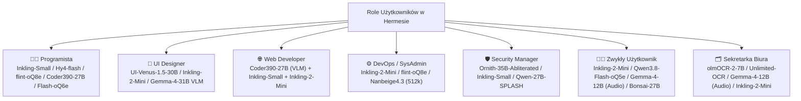

# Przewodnik Użytkownika: Jak i Do Czego Używać Hermesa z Modelami oMLX

Praktyczna instrukcja obsługi agenta **Hermes** współpracującego z lokalnym serwerem **oMLX** na platformie Apple Silicon (Mac Studio 192 GB Unified Memory, limit GPU Metal podniesiony do **186 GB**). Dokument zawiera ściągawkę z najważniejszych komend CLI oraz dobór optymalnych modeli z bazy **28 skonfigurowanych modeli** w Hermesie (**30 modeli** w oMLX) pod kątem konkretnych ról zawodowych i codziennych scenariuszy użycia.

---

## 1. Szybki Start – Podstawowe Komendy Hermesa

### Uruchamianie sesji z wybranym modelem
Domyślnie Hermes startuje z modelem głównym `Qwen3.8-Flash-Next-oQ5e-mtp` (~67.5–73.0 tok/s, VLM + Lightning MTP). Aby uruchomić go od razu z innym modelem, użyj flagi `-m`:

```bash
# Start z domyślnym modelem głównym (Qwen3.8-Flash-Next-oQ5e-mtp)
hermes

# Start z flagowym gigantem 320B MoE w 4-bit (173.9 GB RAM, VLM + MTP)
hermes -m GLM-5.3-Flash-oQ4e-mtp

# Start z ultra-szybkim modelem kodistycznym Coder390 (27B VLM, ~34.6 tok/s, MTP)
hermes -m Qwen3.8-27B-Coder390-EfficientThink-Opus5.5-GPT6Astra-Grok4.7-DSV4Pro-K3-SFT-RLOO-MTP-DFlash2

# Start z najszybszym modelem ogólnym (~73.5 tok/s z tablicą ngramów)
hermes -m Qwen3.8-Flash-Next-MTPLX-Optimized-Speed

# Błyskawiczne polecenie z linii komend napędzane silnikiem Splash 1.6.1-m1.1 (~69.2 śr. / do 91.2 tok/s)
hermes -m Qwen3.8-27B-Uncensored-MLX-SPLASH -z "Przedstaw w 3 punktach podsumowanie kluczowych zalet silnika Splash w oMLX."
```

### Zmiana modelu i parametrów w trakcie rozmowy
W otwartej sesji czatu Hermesa możesz w każdej chwili przełączyć model bez utraty historii rozmowy:
* `/model` – otwiera interaktywne menu wyboru modelu lub pozwala wpisać nazwę, np.:
  ```text
  /model Qwen3.8-27B-Coder390-EfficientThink-Opus5.5-GPT6Astra-Grok4.7-DSV4Pro-K3-SFT-RLOO-MTP-DFlash2
  ```
* **Poziom rozumowania (`--reasoning`):** Możesz sterować głębokością myślenia (`<think>`):
  ```bash
  hermes -m DeepSeek-V4-Flash-0731-MXFP4-MLX --reasoning high
  ```
  > 💡 **Wskazówka dla `GLM-5.3-Flash-oQ4e-mtp`:** jego szablon `chat_template.jinja` rozpoznaje wyłącznie poziomy `low` i `high` — każda inna wartość (w tym domyślne w Hermesie `medium`) przełącza model w tryb **`Max`**, w którym potrafi generować 6k–12k+ tokenów samego `<think>`. Gdy zależy Ci na zwięźlejszym rozumowaniu, użyj jawnie `--reasoning high` lub `--reasoning low`.
* **Praca na bezpiecznej kopii repozytorium (`--worktree`):** Idealne przy dużych refaktoringach:
  ```bash
  hermes -m Qwen3-Coder-Next-MLX-9bit --worktree
  ```

### Przełączanie Wariantów Kompresji i Serwera (`switch-variant.sh`)
W katalogu konfiguracyjnym (`~/Desktop/Devel/omlx_hermes_config`) znajduje się skrypt zarządzający zachowaniem pamięci i kompresora kontekstu:

```bash
# Wariant 1 (Domyślny / Zero-Swap): Kompresję wykonuje aktualnie załadowany model sesji (0s opóźnienia)
./switch-variant.sh 1

# Wariant 2 (Dual-Model): Qwen 122B jako główny + przypięty w RAM Qwen 27B (~15 GB) jako szybki kompresor
./switch-variant.sh 2

# Praca zdalna poza domem / z laptopa (automatycznie łączy się z Mac Studio przez Tailscale VPN)
./switch-variant.sh 1 --remote
```

### Audyt Użycia i Oszczędzanie Miejsca na SSD (`move_from_SSD_to_HDD.sh`)
Narzędzie bada historię użycia modeli w logach oMLX oraz bazie Hermesa, proponując bezpieczne przeniesienie nieużywanych modeli z SSD na zewnętrzny dysk USB-C:

```bash
# Szybki podgląd kandydatów (dry-run, domyślnie >14 dni bezczynności)
./move_from_SSD_to_HDD.sh --check

# Sprawdzenie kandydatów nieużywanych od ponad 30 dni
./move_from_SSD_to_HDD.sh --days 30 --check

# Interaktywne menu wyboru i bezpieczna migracja (z symlinkowaniem i odświeżeniem oMLX)
./move_from_SSD_to_HDD.sh

# Bezpośrednie przeniesienie konkretnego modelu
./move_from_SSD_to_HDD.sh -t "Step-3.5-Flash"
```

---

## 2. Dobór Modeli pod Kątem Ról (Use Cases)

Poniżej znajduje się zestawienie **7 ról użytkowników** wraz z przypisaniem najlepszych modeli spośród **27 dostępnych modeli w Hermesie (29 w oMLX)**.



---

### 👨‍💻 Rola 1: Programista (Backend, Architektura, Algorytmy, Refaktoring)

Programista potrzebuje dwóch trybów pracy: **błyskawicznej pętli edycji kodu i uruchamiania testów** oraz **głębokiego rozumowania architektonicznego** przy skomplikowanych błędach.

| Zastosowanie | Rekomendowany Model | Dlaczego ten model? |
| :--- | :--- | :--- |
| **Głęboka architektura, wielowarstwowy refaktoring, TDD** | **`Inkling-Small-mxfp4`** | Flagowy model Thinking Machines Inkling 1 Small MoE VLM (42 warstwy, 256 ekspertów, top-6 = ~130.6 GB RAM). W benchmarku OpenCode zaliczył **PASS w 124.4s** ze stałą prędkością **40.2 tok/s** i zerową redundancją narzędzi (`rep=0`). Rewelacyjna spójność, doskonała analiza zależności i wysoka kultura kodu. |
| **Złożona logika, parsery, unikanie pętli halucynacji** | **`Hy4-flash-oQ4h-mtp`** | Tencent Hy4-flash MoE VLM (42 warstwy, 512 ekspertów, top-16, innowacyjny format `oQh`, ~123.4 GB RAM). W oMLX 0.8.3 po poprawkach `#5534` i `#5476` zaliczył skok jakości z 3/10 do **10/10** (**PASS w 181.7s**, **35.7 tok/s**, akceptacja Lightning MTP aż **84.9% (`2.96 tok/cykl`)**). |
| **Autonomiczna pętla agenta (SWE-bench, terminal coding)** | **`flint-oQ8e`** | MoE 39.8B (256 ekspertów, 2.5B akt./tok, ~39.4 GB RAM). Wyposażony w dedykowany kernel decode, reasoning `<think>`, generujący aż **60.6–74.1 tok/s**! Znakomity w autonomicznych pętlach naprawiania błędów w terminalu. |
| **Codzienny coding, szybkie diffy, edycja komponentów** | **`Qwen3.8-27B-Coder390-EfficientThink-Opus5.5-GPT6Astra-Grok4.7-DSV4Pro-K3-SFT-RLOO-MTP-DFlash2`** | Wagi unquantized BF16 (~30.6 GB RAM), multimodalny VLM z MTP i akceleracją DFlash2. Generuje kod z prędkością **~34.6 tok/s**, czerpiąc z destylacji Opus 5.5, GPT-6 Astra, Grok 4.7 i DeepSeek V4 Pro. |
| **Precyzyjny refaktoring dużych repozytoriów (VLM 6-bit)** | **`Qwen3.8-Flash-Next-oQ6e-mtp`** | Wyższa precyzja wag 6-bit (~141.1 GB RAM), `activation_fp16_enabled`, Lightning MTP (**64.2 tok/s**, PASS w 129.1s w OpenCode). Świetny balans dokładności i prędkości. |

**Przykładowe użycie:**
```bash
# Głęboka sesja programistyczna i refaktoring z Inkling Small
hermes -m Inkling-Small-mxfp4 -z "Przeanalizuj architekturę modułu agenta, zoptymalizuj zarządzanie stanem i przygotuj zestaw testów jednostkowych w pytest."

# Szybka sesja naprawy testów z Coder390
hermes -m Qwen3.8-27B-Coder390-EfficientThink-Opus5.5-GPT6Astra-Grok4.7-DSV4Pro-K3-SFT-RLOO-MTP-DFlash2 -z "Przeanalizuj błędy w pytest, znajdź przyczynę wyścigu wątków w module worker.py i zastosuj poprawkę."
```

---

### 🎨 Rola 2: UI Designer (Analiza Interfejsów, UX, Design Systems, Makiety)

UI Designer pracuje z obrazem: zrzutami ekranu aplikacji, eksportami z Figmy, siatkami odstępów, kontrastem i hierarchią wizualną. Wymaga modeli posiadających silny moduł **Vision (VLM)**.

| Zastosowanie | Rekomendowany Model | Dlaczego ten model? |
| :--- | :--- | :--- |
| **Analiza screenshotów UI, audyt UX, lokalizacja elementów** | **`UI-Venus-1.5-30B-A3B-qx86-hi-mlx`** | Wyspecjalizowany model multimodalny (Qwen 3 VL MoE, ~30 GB RAM) wytrenowany do rozumienia interfejsów graficznych, hierarchii komponentów, dostępności (WCAG) i wykrywania błędów wizualnych (**54.7 tok/s**). |
| **Lekki asystent UX, ocena spójności wizualnej w pętli** | **`Inkling-2-Mini-oQ4e-mtp`** | Niezwykle sprawny VLM MoE (128 ekspertów, pętla `3× pass`, zaledwie **15.65 GB RAM**). W oMLX 0.8.3 generuje **41.2 tok/s** (PASS w **112.4s**), tworząc przejrzyste, tabelaryczne audyty UI. |
| **Szczegółowa analiza design systemów i typografii** | **`gemma-4-31B-it-oQ6e-mtp`** | Gęsty 31B VLM od Google (~26.3 GB RAM) z dedykowanym kernelem weryfikacji i MTP (88.4% akceptacji, **32.4–34.0 tok/s**). Świetnie analizuje złożone layouty graficzne. |

**Przykładowe użycie:**
```bash
# Audyt UX na podstawie zrzutu ekranu makiety
hermes -m UI-Venus-1.5-30B-A3B-qx86-hi-mlx -z "Przeanalizuj plik ./mockup_dashboard.png pod kątem czytelności hierarchii informacji, kontrastu przycisków CTA oraz spójności paddingów."
```

---

### 🌐 Rola 3: Web Developer (Full-Stack, React/Next.js, Tailwind CSS, Design-to-Code)

Web Developer łączy świat UI Designera i Programisty: musi przekształcić projekt graficzny w działający, responsywny komponent HTML/CSS/React, a gdy coś się rozjedzie w przeglądarce – pokazać modelowi zrzut ekranu i kod jednocześnie.

| Zastosowanie | Rekomendowany Model | Dlaczego ten model? |
| :--- | :--- | :--- |
| **Tworzenie komponentów React/Vue/Tailwind + podgląd wizji** | **`Qwen3.8-27B-Coder390-EfficientThink-Opus5.5-GPT6Astra-Grok4.7-DSV4Pro-K3-SFT-RLOO-MTP-DFlash2`** | Model programistyczny z **aktywną wieżą wizyjną (`supports_vision: true`)** i pełną precyzją BF16! Możesz wkleić mu screenshot rozjechanego modala w przeglądarce, a on sam przejrzy kod CSS i naprawi flexbox/grid. |
| **Konwersja makiety na kod (Screenshot-to-Code)** | **`UI-Venus-1.5-30B-A3B-qx86-hi-mlx`** | Najdokładniej odwzorowuje układ przestrzenny z obrazka na strukturę DOM i klasy Tailwind CSS. |
| **Architektura Full-Stack, integracja API, SSR i bazy danych** | **`Inkling-Small-mxfp4`** | VLM z 256 ekspertami MoE (~130.6 GB RAM, **40.2 tok/s**). Perfekcyjnie łączy wizję UI ze złożoną logiką backendową w TypeScript / Next.js. |
| **Błyskawiczne poprawki stylów i komponentów na żywo** | **`Inkling-2-Mini-oQ4e-mtp`** | Lekki VLM (**15.7 GB RAM**, **41.2 tok/s**). Idealny do natychmiastowych iteracji nad kodem frontendowym i podglądu zrzutów ekranu. |

**Przykładowe użycie:**
```bash
# Debugowanie wizualne + kodowe jednocześnie (VLM Coder)
hermes -m Qwen3.8-27B-Coder390-EfficientThink-Opus5.5-GPT6Astra-Grok4.7-DSV4Pro-K3-SFT-RLOO-MTP-DFlash2 -z "Zobacz zrzut ekranu ./bug_mobile_nav.png – menu nachodzi na hero section na ekranie 375px. Sprawdź plik src/components/Navbar.tsx i napraw klasy Tailwind."
```

---

### ⚙️ Rola 4: DevOps / SysAdmin (Infrastruktura, Docker, K8s, CI/CD, Analiza Logów)

Praca DevOpsa w Hermesie to wykonywanie dziesiątek komend diagnostycznych w terminalu (`ps`, `lsof`, `journalctl`, `kubectl`, `docker logs`), analiza gigantycznych plików logów oraz pisanie skryptów Bash/Ansible/Terraform, gdzie liczy się **zero błędów składniowych w JSON/YAML** i **duża szybkość reakcji**.

| Zastosowanie | Rekomendowany Model | Dlaczego ten model? |
| :--- | :--- | :--- |
| **Szybkie pętle diagnostyczne w CLI, automatyzacja zadań** | **`Inkling-2-Mini-oQ4e-mtp`** | Niezwykle lekki (**15.65 GB RAM**), generuje aż **41.2 tok/s** i w benchmarku OpenCode ukończył zadanie w **112.4s** bez ani jednego błędu narzędzi (`rep=0`). Błyskawiczny start i minimalne obciążenie RAM. |
| **Autonomiczne diagnozowanie awarii i naprawa skryptów** | **`flint-oQ8e`** | MoE 39.8B (~39.4 GB RAM, **60.6 tok/s**). Wyspecjalizowany w pracy terminalowej i wielokrokowym wykonywaniu komend diagnostycznych z natywnym myśleniem `<think>`. |
| **Analiza gigantycznych zrzutów logów i konfiguracji (Okno 512k)** | **`Nanbeige4.3-33B-MLX-6bit`** | Gęsty model 33B z rekordowym oknem kontekstu **524 288 tokenów (512k)** (~25.2 GB RAM). Pozwala wczytać setki tysięcy linii logów systemowych w jednej sesji. |
| **Maksymalna prędkość odpowiedzi przy komendach CLI** | **`Qwen3.8-Flash-Next-MTPLX-Optimized-Speed`** | Prędkość **~73.5 tok/s** i pełne okno **256k tokenów**. Błyskawicznie parsuje wyjścia komend systemowych. |

**Przykładowe użycie:**
```bash
# Diagnostyka usług systemowych i logów z Inkling 2 Mini
hermes -m Inkling-2-Mini-oQ4e-mtp -z "Sprawdź procesy obciążające pamięć, zweryfikuj status usług launchd związanych z omlx i przeanalizuj ostatnie 300 linii logów serwera pod kątem timeoutów."
```

---

### 🛡️ Rola 5: Security Manager / Pentester (Audyt Bezpieczeństwa, Red/Blue Team, DevSecOps)

Specjaliści ds. bezpieczeństwa często napotykają problem w komercyjnych modelach: **fałszywe odmowy (refusals)** przy prośbach o analizę podatności, wygenerowanie testowego payloadu XSS/SQLi, analizę złośliwego skryptu czy weryfikację reguł WAF.

| Zastosowanie | Rekomendowany Model | Dlaczego ten model? |
| :--- | :--- | :--- |
| **Scenariusze Red-Team, analiza exploitów i malware (bez cenzury)** | **`Ornith-1.5-35B-A3B-Abliterated-MLX-BF16`** | Pełna precyzja **BF16** (~64.6 GB RAM) z usuniętymi wektorami odmów (*Abliterated*). Bardzo szybki (**52.0 tok/s**, PASS w 70.9s w OpenCode!). Nie prawi morałów – rzeczowo analizuje złośliwy kod, uprawnienia i scenariusze penetracyjne. |
| **Audyt architektury bezpieczeństwa, modelowanie zagrożeń (STRIDE)** | **`Inkling-Small-mxfp4`** | 256 ekspertów MoE VLM (~130.6 GB RAM, **40.2 tok/s**). Dokładnie bada zależności, architekturę sieciową, uprawnienia RBAC i przepływy danych pod kątem podatności logicznych. |
| **Błyskawiczne zapytania o polityki i reguły (Splash Engine)** | **`Qwen3.8-27B-Uncensored-MLX-SPLASH`** | Silnik Splash 1.7.0-m1.1 osiągający aż **72.9 tok/s** decode. Bezkompromisowa szybkość przy przeglądaniu reguł firewalla, polityk IAM i logów SIEM bez cenzury. |
| **Audyt bezpieczeństwa kodu (SAST), testy CTF** | **`Qwen3.8-27B-Coder390-EfficientThink-Opus5.5-GPT6Astra-Grok4.7-DSV4Pro-K3-SFT-RLOO-MTP-DFlash2`** | Topowy model kodujący BF16 (~30.6 GB RAM). Błyskawicznie wykrywa luki OWASP Top 10 w kodzie i proponuje bezpieczne łatki. |

**Przykładowe użycie:**
```bash
# Analiza podejrzanego skryptu z Ornith Abliterated
hermes -m Ornith-1.5-35B-A3B-Abliterated-MLX-BF16 -z "Zdekoduj i przeanalizuj działanie tego zaciemnionego skryptu PowerShell znalezionego podczas analizy incydentu. Jakie wskaźniki kompromitacji (IoC) zostawia w systemie?"
```

---

### 🧑‍💼 Rola 6: Zwykły Użytkownik (Everyday User – Asystent Codzienny, Nauka, Research)

Do codziennych pytań, burzy mózgów, planowania podróży, tłumaczeń, streszczania artykułów czy nauki nowych tematów najważniejsze są: **naturalność języka, szybkość odpowiedzi, wysoka wiedza ogólna oraz multimodalność**.

| Zastosowanie | Rekomendowany Model | Dlaczego ten model? |
| :--- | :--- | :--- |
| **Codzienny, lekki i niezwykle dokładny asystent VLM** | **`Inkling-2-Mini-oQ4e-mtp`** | **Rewelacja na co dzień.** Zajmuje zaledwie **15.65 GB RAM**, generuje **41.2 tok/s** i tworzy wybitnie przejrzyste odpowiedzi z tabelami i podsumowaniami. Działa błyskawicznie, nie obciążając komputera. |
| **Domyślny flagowiec do wszystkiego (Złoty Środek)** | **`Qwen3.8-Flash-Next-oQ5e-mtp`** | **Domyślny model systemu.** Świetny balans wiedzy, kodowania i wizji (format `oQ5e`, ~120 GB RAM, **61.0–97 tok/s**). |
| **Asystent głosowy, transkrypcje i multimodalność Any-to-Any** | **`gemma-4-12B-it-oQ8e-mtp`** | Model Google Gemma 4 (~13.0 GB RAM) z natywną obsługą tekstu, obrazu oraz **audio**! Możesz przekazywać mu pliki dźwiękowe, dyktować notatki i otrzymywać odpowiedzi w prędkości **51.4–68.4 tok/s**. |
| **Ekonomiczny model 27B w minimalnej pamięci RAM** | **`Ternary-Bonsai-2-27B-MTPLX-Optimized-Speed`** | Kwantyzacja 2-bit Hadamard: pełny model 27B VLM mieszczący się w zaledwie **8.23 GB RAM** (**31.4 tok/s**). Pozwala na pracę w tle z minimalnym zużyciem pamięci. |

**Przykładowe użycie:**
```bash
# Codzienny asystent z Inkling 2 Mini
hermes -m Inkling-2-Mini-oQ4e-mtp -z "Wyjaśnij mi w przystępnej tabeli różnicę między oprocentowaniem stałym a zmiennym przy nadpłacaniu kredytu i policz symulację dla 300 tys. zł."
```

---

### 🗂️ Rola 7: Sekretarka Biura / Office Manager (Faktury, OCR Dokumentów, Audio i Pisma)

W pracy biurowej kluczowe są: **bezbłędne odczytywanie tekstu z trudnych skanów, faktur, paragonów i wielokolumnowych PDF-ów (OCR)**, **praca z nagraniami audio** oraz **redagowanie nienagannych pism, maili i protokołów w języku polskim**.

| Zastosowanie | Rekomendowany Model | Dlaczego ten model? |
| :--- | :--- | :--- |
| **Odczyt skomplikowanych PDF-ów, umów, tabel i wielokolumnowych pism** | **`olmOCR-2-7B-1025-8bit`** | Wyspecjalizowany model VLM od AllenAI ściśle do konwersji trudnych dokumentów PDF i skanów na czysty tekst i tabele Markdown (niska temperatura `0.2` zapobiega zmyślaniu danych). |
| **Odczyt faktur, paragonów, etykiet kurierskich w wysokiej rozdzielczości** | **`Unlimited-OCR-8bit`** | Model OCR bez limitu rozdzielczości obrazu (tiling 2D). Odczyta nawet drobny druk na sfotografowanej fakturze czy tabeli kosztorysowej. |
| **Transkrypcja nagrań ze spotkań, notatek głosowych i dyktafonu** | **`gemma-4-12B-it-oQ8e-mtp`** | Multimodalny model Any-to-Any (~13.0 GB RAM, **51.4–68.4 tok/s**) z natywnym modułem **Audio**. Przetwarza nagrania dźwiękowe bezpośrednio na protokoły i zwięzłe podsumowania. |
| **Analiza wielostronicowych pism, raportów i tworzenie zestawień** | **`Inkling-2-Mini-oQ4e-mtp`** | Lekki VLM (**15.65 GB RAM**, **41.2 tok/s**). Znakomicie radzi sobie z analizą wieloetapową i przygotowywaniem przejrzystych zestawień tabelarycznych. |

**Przykładowe użycie:**
```bash
# Krok 1: Wyciągnięcie danych z zeskanowanej faktury do tabeli (OCR)
hermes -m Unlimited-OCR-8bit -z "Odczytaj wszystkie pozycje z faktury ./skan_faktury_04.jpg. Zwróć dane w tabeli: Nazwa towaru, Ilość, Cena netto, VAT, Kwota brutto oraz podaj NIP sprzedawcy i numer konta."

# Krok 2: Przygotowanie protokołu z nagrania audio
hermes -m gemma-4-12B-it-oQ8e-mtp -z "Przeanalizuj plik nagrania ./spotkanie_zarzadu.m4a i przygotuj oficjalny protokół ze spisem ustaleń i przypisanych zadań."
```

---

## 3. Wielka Ściąga: Katalog Wszystkich 28 Modeli w Hermesie (30 w oMLX)

Poniższa tabela pozwala szybko porównać wszystkie 28 modeli pod kątem ich rozmiaru w pamięci RAM, okna kontekstu oraz głównego przeznaczenia:

| # | Nazwa Modelu (`hermes -m ...`) | Kategoria | Okno | Rozmiar RAM | Vision (VLM) | Kiedy wybierać? |
| :-: | :--- | :--- | :---: | :---: | :---: | :--- |
| 1 | **`Qwen3.8-Flash-Next-oQ5e-mtp`** | 🏆 Domyślny / Szybki VLM | 256k | ~119.9 GB | **Tak** | **Domyślny model.** Znakomity balans jakości (`oQ5e` iMatrix), **100 ścieżek Affine `hc_fused`**, `activation_fp16_enabled` oraz **Lightning MTP (67.5–97 tok/s)**. |
| 2 | **`Qwen3.8-Flash-Next-oQ6e-mtp`** | 🎯 Wyższa Precyzja 6-bit VLM | 256k | ~141.1 GB | **Tak** | Gdy zależy Ci na wyższej, 6-bitowej precyzji wag `Qwen3.8-Flash-Next` z Lightning MTP (**60.6–63.9 tok/s**, TTFT 0.58s). |
| 3 | **`Qwen3.8-Flash-Next-MTPLX-Optimized-Speed`** | ⚡ Ultra-Fast Agent | 256k | ~120.8 GB | **Tak** | Gdy liczy się **maksymalna prędkość (~73.5 tok/s, Fused GDN Decode + 128 shardów N-gram)** w długich sesjach agentowych i obsługa obrazów. |
| 4 | **`GLM-5.3-Flash-oQ4e-mtp`** | 🏛️ Kolos 320B MoE (4-bit) | 256k | ~173.9 GB | **Tak** | Flagowy 320B MoE (18B akt./tok) w 100% w RAM (limit 186 GB), Fused KDA prework, **TTFT 0.17s**, Lightning MTP (82.5% akceptacji, **25.9–29.9 tok/s**). |
| 4a | **`Hy4-flash-oQ4h-mtp`** | 🐉 Tencent Hy4-flash (`oQ4h`) | 256k | ~123.4 GB | **Tak** | 512 eksp. (top-16), `oQh` w oMLX `0.8.3` (`#5534`/`#5476` naprawione!), Lightning MTP (**84.9%**), **35.7 tok/s** (PASS `181.7s`, 10/10 jakość). |
| 4b | **`Inkling-2-Mini-oQ4e-mtp`** | ⚡ Lekki Agent VLM (oMLX 0.8.4) | 256k | ~16.6 GB | **Tak** | Natywny oMLX `0.8.4` + DSpark (**52.5 tok/s śr. / 71.6 szczyt**, `16.9s` prefill 20k, PASS `112.9s`, `5011 zn.`). |
| 4b-s | **`Inkling-2-Mini-oQ4e-mtp-SPLASH`** | ⚡ Lekki Agent VLM (Splash) | 256k | ~23.1 GB | **Tak** | Silnik **Splash `1.7.3-m1`** + `Inkling-2-Mini-DFlash2` (**57.4 tok/s śr. / 68.5 szczyt**, TTFT `1.62s`, PASS `140.1s`). |
| 4c | **`Inkling-Small-mxfp4`** | 🧠 Inkling 1 Small (MXFP4) | 256k | ~130.6 GB | **Tak** | Thinking Machines Inkling 1 Small (256 eksp. top-6, VLM, **40.2 tok/s**, PASS `124.4s` w OpenCode). |
| 5 | **`gemma-4-12B-it-oQ8e-mtp`** | ⚡ Any-to-Any (VLM + Audio) | 256k | ~13.0 GB | **Tak (+Audio)** | Lekki, błyskawiczny model Google Gemma 4 (`gemma4_unified`, 8-bit, FP16 recast, Lightning MTP do `d8`, **51.4–68.4 tok/s**). |
| 6 | **`gemma-4-31B-it-oQ6e-mtp`** | 🧠 Dense 31B VLM (Gemma 4) | 256k | ~26.3 GB | **Tak** | Gęsty model 31B VLM z dedykowanym kernelem `gemma4_verify_kernel`, FP16 recast (+42% speedup) i akceptacją MTP **88.4% (`4.38 tok/cykl`, 32.4–34.0 tok/s)**. |
| 7 | **`Ternary-Bonsai-2-27B-MTPLX-Optimized-Speed`** | 🪶 Ultralekki 27B Hadamard | 256k | **~8.23 GB** | **Tak** | Kwantyzacja 2-bit Hadamard (`prism_hadamard_qwen35`): pełny model 27B VLM zajmujący zaledwie **8.23 GB RAM** i generujący **31.4 tok/s**. |
| 8 | **`Nanbeige4.3-33B-MLX-6bit`** | 📚 Gęsty 33B / Okno **512k** | **512k** | ~25.2 GB | Nie | Gęsty model 33B do zadań agentowych i analizy gigantycznych repozytoriów z oknem aż **524 288 tokenów (512k)** (**19.6 tok/s**). |
| 9 | **`flint-oQ8e`** | 🤖 Autonomous Agent MoE | 256k | ~39.4 GB | Nie | **Lider agentic coding** (SWE-bench, Terminal-Bench), MoE 40B (256 eksp., 2.5B akt./tok), oQ8e iMatrix, dedykowany kernel decode, do **74.1 tok/s**. |
| 10 | **`Qwen3.8-27B-Coder390-EfficientThink-Opus5.5-`**<br>**`GPT6Astra-Grok4.7-DSV4Pro-K3-SFT-RLOO-MTP-DFlash2`** | 💻 Top Coder VLM | 256k | ~30.6 GB | **Tak** | **Nowoczesne programowanie** (34.6 tok/s, destylacje Opus 5.5, GPT-6, Grok 4.7, VLM, natywne Lightning MTP `mtp-bf16`, 8-bit KV Cache). |
| 11 | **`Qwen3.8-27B-Uncensored-MLX-SPLASH`** | ⚡ Splash Engine 27B / Kompresor | 256k | ~15 GB | Nie | Ultraszybki silnik **Splash 1.7.0-m1.1** (One memory ledger, Idle KV, Metal/ANE split `0.26` + DFlash2, **72.9 tok/s** decode, hotfix `#75`); przypięty kompresor Wariantu 2. |
| 12 | **`Qwen3.8-27B-Uncensored-MLX`** | 🔓 Szybki Uncensored (MLX) | 256k | ~15 GB | Nie | Bardzo lekki model bez cenzury z natywnym dekodowaniem spekulatywnym **DFlash2 (`Qwen3.8-27B-DFlash2`)** i 8-bit KV Cache. |
| 13 | **`DeepSeek-V4-Flash-0731-MXFP4-MLX`** | 🧠 Deep Reasoning | 256k | ~159 GB | Nie | Najtrudniejsze problemy algorytmiczne i architektoniczne (embedded DSpark MTP depth 3, **31–34.6 tok/s** do 45k, **~21–24 tok/s** przy >210k). |
| 14 | **`DeepSeek-V4-Flash-0731-AWQ`** | 🧠 Reasoning (Lżejszy) | 256k | ~100 GB | Nie | Lżejsza alternatywa dla DeepSeek V4 (Lightning MTP + MLA), gdy potrzebujesz mniejszego zużycia RAM. |
| 15 | **`MiniMax-M3-ConfigI-MLX`** *(`[HDD]`)* | 🗄️ Archiwum HDD (Multimodal MoE) | 128k | ~156 GB | **Tak** | Zarchiwizowany na USB-C HDD (`/Volumes/Seagate_Expansion_Drive/LLM`); w oMLX 0.8.0 naprawiono `#5233` (`masked sparse fallback` >4k tok, `25.1 tok/s`). |
| 16 | **`Ornith-1.5-35B-A3B-Abliterated-MLX-BF16`** | 🔓 Uncensored BF16 | 256k | ~70 GB | Nie | Zadania Red-Team, pentesting i tematy wrażliwe w bezstratnej jakości BF16 bez cenzury (**52.0 tok/s**). |
| 17 | **`Step-3.5-Flash-4bit`** | ⚙️ Szybki MoE (Sliding) | 256k | ~45 GB | Nie | Szybki model ogólny z oknem przesuwnym (sliding window 512) i Fused MoE do pracy narzędziowej. |
| 18 | **`Laguna-S-2.1-MLX-8bit`** | 🛠️ Specjalistyczny Coding | 256k | ~25 GB | Nie | Model z natywnym parserem `laguna` w oMLX 0.7.2+, Fused MoE i sliding window 512 do zadań inżynierskich. |
| 19 | **`UI-Venus-1.5-30B-A3B-qx86-hi-mlx`** | 🎨 UI / UX Vision | 256k | ~30 GB | **Tak** | Analiza interfejsów użytkownika, makiet, design-to-code i elementów graficznych (**54.7 tok/s**). |
| 20 | **`olmOCR-2-7B-1025-8bit`** | 📄 Dokumenty OCR | 128k | ~8.8 GB | **Tak** | Konwersja skanów PDF, pism, tabel i układów wielokolumnowych na tekst. |
| 21 | **`Unlimited-OCR-8bit`** | 🧾 Faktury Hi-Res OCR | 32k | ~3.7 GB | **Tak** | Odczyt faktur, paragonów i obrazów o dowolnie dużej rozdzielczości (tiling 2D). |
| 22 | **`Qwen3.5-122B-A10B-MLX-9bit`** *(`[HDD]`)* | 🗄️ Archiwum HDD (MoE 122B) | 256k | ~128 GB | Nie | Zarchiwizowany na zewnętrznym dysku USB-C `/Volumes/Seagate_Expansion_Drive/LLM` (zastąpiony przez serię `Qwen3.8-Flash-Next`). |
| 23 | **`Qwen3-Coder-Next-MLX-9bit`** *(`[HDD]`)* | 🗄️ Archiwum HDD (Coder 9-bit) | 256k | ~83 GB | Nie | Zarchiwizowany na zewnętrznym dysku USB-C `/Volumes/Seagate_Expansion_Drive/LLM`. |
| 24 | **`Qwen3-235B-A22B-MLX-4bit`** *(`[HDD]`)* | 🗄️ Archiwum HDD (Kolos 235B) | 40k | ~116 GB | Nie | Zarchiwizowany na zewnętrznym dysku USB-C `/Volumes/Seagate_Expansion_Drive/LLM`. |
| 25 | **`Qwen3.8-27B-FP16_huzar_v1`** *(`[HDD]`)* | 🗄️ Archiwum HDD (Dense FP16) | 256k | ~54 GB | Nie | Wersja FP16 Huzar v1 zarchiwizowana na USB-C HDD. |
| 26 | **`Qwen3.8-27B-FP16_huzar_v1-SPLASH`** *(`[HDD]`)* | 🗄️ Archiwum HDD (Splash FP16) | 256k | ~54 GB | Nie | Wariant Splash dla FP16 Huzar zarchiwizowany na USB-C HDD. |

---

## 4. Dobre Praktyki i Zarządzanie Pamięcią (Mac Studio 192 GB)

1. **Zasada Jednego Modelu w RAM (Watchdog 180s):**
   - W tle działa demon `com.hermes.omlx-single-model-guard`, który co 3 minuty sprawdza, czy w pamięci RAM nie zalegają nieużywane modele.
   - Dzięki temu możesz swobodnie przełączać się między gigantycznymi modelami (np. z `MiniMax-M3` 156 GB na `DeepSeek-V4` 155 GB) bez ryzyka zapchania pamięci Unified Memory.

2. **Kiedy wybrać Wariant 1, a kiedy Wariant 2?**
   - **Wybierz Wariant 1 (`./switch-variant.sh 1` – Domyślny / Zero-Swap):**
     * **Zasada:** Kompresję długiego kontekstu wykonuje ten sam model, który aktualnie prowadzi sesję (`provider: auto`).
     * **Kiedy stosować:** Gdy często zmieniasz modele w zależności od roli lub gdy korzystasz z potężnych modeli (>150 GB RAM).
     * **Zalety:** 100% zunifikowanej pamięci (192 GB) pozostaje do dyspozycji aktywnego modelu, brak narzutu na dodatkowy model w RAM.
   - **Wybierz Wariant 2 (`./switch-variant.sh 2` – Dual-Model Resident):**
     * **Zasada:** Model główny (np. `Qwen3.8-Flash-Next-oQ5e-mtp`) współistnieje w RAM z przypiętym na stałe małym, dedykowanym kompresorem `Qwen3.8-27B-Uncensored-MLX-SPLASH` (~15.2 GB, silnik **Splash 1.7.0-m1.1**).
     * **Wydajność kompresora Splash:** Osiąga aż **72.9 tok/s** decode (lider przepustowości w testach), minimalny TTFT **0.31 s**, akcelerację spekulatywną DFlash2 na poziomie **3.92 tok/cykl** oraz hybrydowy podział warstw FFN na Neural Engine (share `0.26`). Cały proces kompresji 2 168 tokenów kontekstu trwa zaledwie **10.5 s**.
     * **Kiedy stosować:** Gdy prowadzisz długie, intensywne sesje na modelach o rozmiarze do ~130 GB RAM (np. `Qwen3.8-Flash-Next`, `Coder390`, `Inkling-2-Mini`, `Ternary-Bonsai`) i chcesz natychmiastowego, bezstratnego streszczania kontekstu bez odrywania modelu głównego.

3. **Praca z bardzo dużymi modelami (>150 GB RAM) – Bezwzględny Wariant 1:**
   - Podczas korzystania z modeli:
     * `DeepSeek-V4-Flash-0731-MXFP4-MLX` (waga modelu: **158.84 GB**)
     * `MiniMax-M3-ConfigI-MLX` (waga modelu: **156.0 GB**)
   - **Zawsze przełącz na Wariant 1 (`./switch-variant.sh 1`)!**
   - *Dlaczego?* W Wariancie 2 obecność rezydentnego kompresora Splash (~15.2 GB) podnosi łączną alokację do >174 GB, co przy dynamicznym suficie pamięci oMLX (~178.5 GB) wywołuje błąd `HTTP 507: Cannot load model: projected memory would exceed dynamic memory ceiling`. W Wariancie 1 demon Watchdoga dba o to, by w pamięci znajdował się wyłącznie jeden kolos, pozostawiając ~33 GB RAM na bufory KV Cache.

4. **Wpływ długości kontekstu na prędkość `DeepSeek-V4-Flash-0731-MXFP4-MLX`:**
   - Na krótkim i średnim kontekście (`<45k` tokenów) model generuje z prędkością **31.0–34.6 tok/s** (czas kroku `backbone ~95 ms`, akceptacja wbudowanego draftera DSpark MTP na poziomie `91–96%`).
   - Gdy sesja przekroczy **`210k–232k` tokenów**, prędkość spada do **21.0–23.7 tok/s** — jest to naturalne zachowanie wynikające z dwóch czynników: oMLX automatycznie wyłącza kompresję TurboQuant KV dla tej architektury z powodu użycia *attention sinks* (zachowując `fp16` KV cache przy `158.8 GB` zajętego RAM-u), przez co krok `backbone` wydłuża się do `~128 ms`, a przy długich wywołaniach narzędzi (`tool_calls`) akceptacja MTP spada do `80–84%`.
   - Po automatycznej kompresji historii rozmowy (np. z `232k` do `~66k` tokenów) prędkość natychmiast wraca w okolice **30.0 tok/s**.

5. **Qwen3.8-Flash-Next: oMLX (MLX w 192 GB RAM) vs Splash (GGUF ze strumieniowaniem SSD):**
   - **W oMLX (nasza konfiguracja):**
     * Posiadamy na dysku natywne wagi MLX safetensors: `Qwen3.8-Flash-Next-oQ5e-mtp` (~125 GB) oraz `Qwen3.8-Flash-Next-MTPLX-Optimized-Speed` (~145 GB).
     * Dzięki **192 GB Unified Memory** cały model — w tym pełna 30-gigabajtowa tablica n-gramów PLE oraz 512 ekspertów MoE — ładuje się w 100% do pamięci RAM.
     * W oMLX z Lightning MTP i zespolonymi kernelami GDN (`qwen4_gdn_decode_wide_proj: true`) model ten osiąga zawrotną prędkość **73.5 – 75+ tok/s**!
   - **W Splashu (`1.4.0-m1`):**
     * Silnik Splash obsługuje `Qwen3.8-Flash-Next` **wyłącznie z formatu GGUF** (`_GGUF_ONLY_FAMILIES`). Checkpointy MLX safetensors są przez Splasha odrzucane (`error: Qwen3.8-Flash-Next loads from a GGUF only`).
     * Splash został zaprojektowany z myślą o komputerach z mniejszą pamięcią (32 GB / 64 GB RAM), wykorzystując strumieniowanie PLE z dysku SSD (`--ple-memory 2G`) i uzyskując na M1 Max około **~47 tok/s**.
     * **Rekomendacja:** Na Mac Studio 192 GB nie ma potrzeby godzić się na kompromisy strumieniowania z dysku. Używaj modeli Flash-Next bezpośrednio w **oMLX**, uzyskując pełną rezydentność w RAM i najwyższą możliwą prędkość generowania (**73.5 tok/s**).

6. **Hierarchiczne Zarządzanie Magazynem Modeli (Szybki SSD vs Zewnętrzny Seagate HDD):**
   - Na wewnętrznym dysku SSD przechowujemy modele używane na co dzień oraz te, które wymagają najwyższej przepustowości I/O przy ładowaniu do RAM.
   - Gdy miejsce na SSD spada, uruchom `./move_from_SSD_to_HDD.sh --check`.
   - Skrypt przeanalizuje czasy ostatnich wywołań w logach oMLX i bazie SQLite Hermesa, po czym umożliwi bezpieczne przeniesienie wybranych modeli na `/Volumes/Seagate_Expansion_Drive/LLM`.
   - W miejscu oryginalnych plików tworzone są dowiązania symboliczne (`symlink`), a w oMLX i OpenCode model otrzymuje etykietę `[HDD]`. W ten sposób model pozostaje w 100% sprawny i dostępny w menu, nie zajmując ani megabajta na wewnętrznym SSD!
